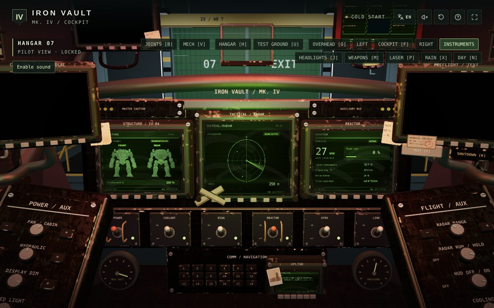
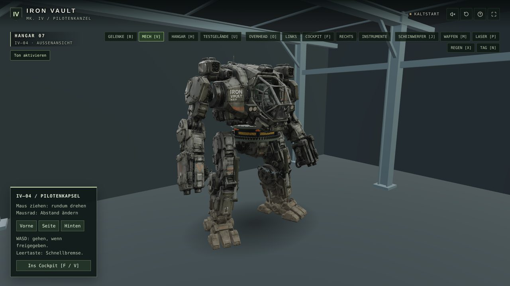
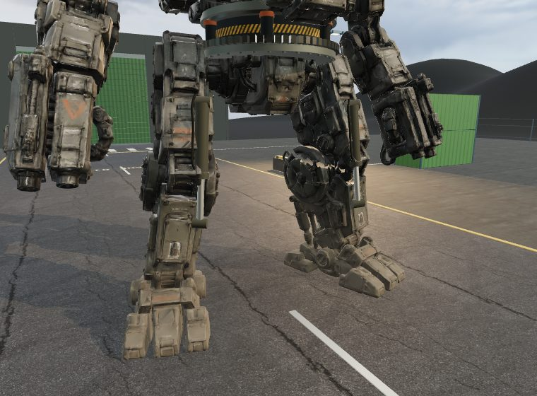
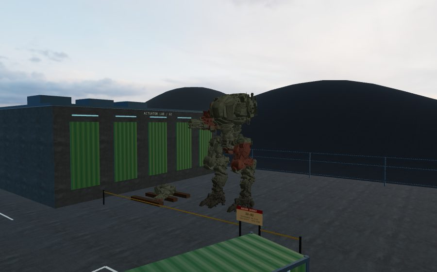

# IRON VAULT

**English** · [Deutsch](README.de.md)

A cockpit simulation of an old, worn-out walking mech – **IV-04** – in 3D. You sit in the
pilot capsule, bring the machine up from a cold start switch by switch, walk it out of the
hangar onto the test ground and fire its arm cannons at the firing range. Runs in the
browser or as a Linux desktop app.



## Features

- **A real cold start:** batteries, fuel pump, APU, coolant, hydraulics, reactor, gyro,
  neuro helmet and system test – 20 checklist steps until control clearance. Ten working
  cockpit displays with checklists guide you through it.
- **Simulated systems:** power with batteries, APU, hangar power and overload protection;
  coolant circuit with pumps, leaks and residual heat; hydraulics; an orderly shutdown with
  cool-down. Training faults can be triggered on purpose.
- **Walking:** inverse-kinematics legs with feet that stay planted, visible hydraulic
  cylinders, cabin jolt on every step, dust, footprints and step sounds.
- **Torso and arms:** turn the torso, raise and bend the arms.
- **Weapons:** two 30 mm arm cannons with free mouse aiming, laser rangefinder, a firing
  range with knock-down targets.
- **Weather and light:** day/night, headlights and a rotating beacon, rain with wet
  armour, puddles and drops on the windscreen, thunderstorms.
- **An old machine:** flickering CRT displays in toxic green, worn paint, notes and tape in
  the cabin – and, if you add the model yourself, the stripped sister mech **IV-02**,
  parked outside the workshop as a parts donor (see [ASSETS.md](ASSETS.md)).
- **German and English**, switchable at any time.

| | |
| --- | --- |
|  |  |
|  | |

## Download (Linux desktop app)

Get the latest `IRON_VAULT-…-x86_64.AppImage` from
[Releases](https://github.com/MRFloyd84/iron-vault/releases/latest), plus `install-desktop.sh`.

```sh
sudo pacman -S fuse2          # Arch/CachyOS, once – AppImages need FUSE 2
                              # (Debian/Ubuntu: sudo apt install libfuse2)
bash install-desktop.sh IRON_VAULT-0.59.0-x86_64.AppImage
```

This installs IRON VAULT for your user only (no root) with a start menu entry. The app
**updates itself**: on start it checks the GitHub releases, downloads a new version in the
background and offers a restart. Remove it with `bash install-desktop.sh --remove`.

Without installing: `chmod +x` the AppImage and run it.

## Run from source

Requirements: Node.js 22.13 or newer and npm.

```sh
git clone https://github.com/MRFloyd84/iron-vault.git
cd iron-vault
npm ci
npm run dev          # http://127.0.0.1:5173
```

| Command | Purpose |
| --- | --- |
| `npm run dev` | development server |
| `npm run build` | type check and static build into `dist/` (any web server will do) |
| `npm run app` | open the desktop window straight from the project |
| `npm run dist:linux` | build the AppImage into `release/` |
| `npm test` | all tests (state logic, audio, displays, geometry, translations) |
| `npm run check` | types, lint, tests and build together |

A new version number in `package.json` pushed to `main` is built and published as a
release automatically by GitHub Actions.

## Getting started in the cockpit

The **?** button (top right) explains everything. In short:

| Key | Action |
| --- | --- |
| Right mouse button | look around |
| Left mouse button | operate switches, click monitors to zoom in |
| O | overhead panel: BAT 1, BAT 2, FUEL PUMP, APU … |
| G | connect hangar power (cold start without the APU) |
| 1 – 6 | main power, cooling, diagnostics, reactor, stabilisation, control link |
| T / K | system test / shutdown |
| W A S D, Space | walk, turn, brake |
| Q / E, B | turn the torso, joint panel |
| V / H / U | mech exterior / hangar camera / test ground |
| M, P, J | weapons, laser, headlights |
| N, X, L | day/night, rain, cabin light |

## Technology

React 19, three.js, Vite and TypeScript; Electron and electron-builder for the desktop
app. Everything runs locally – no CDNs at runtime. The displays are canvas textures on
real 3D screens; ageing, wear, rain and paint are shaders. Sounds are recordings plus
Web Audio synthesis.

| Folder | Contents |
| --- | --- |
| `app/` | React user interface |
| `lib/` | simulation and 3D scene (`machine.ts` state machine, `cockpit-scene.ts` scene) |
| `public/` | models, textures, sounds |
| `scripts/` | asset preparation (models, audio, atlas) and the installer script |
| `electron/` | desktop app |
| `tests/` | Node test runner tests |

Changes per version: `AENDERUNGEN_v46.md` … (German). The development history up to v45 is
in [`docs/ENTWICKLUNG_BIS_v45.md`](docs/ENTWICKLUNG_BIS_v45.md).

## Assets and credits

- **IV-04** is a simplified, re-rigged version of a mech model created with Tripo.
- **IV-02** is based on “Juggernaut” by Megalord (CGTrader, free model). The model is not
  included for licence reasons; `scripts/prepare-sister-mech.mjs` converts your own
  download (10 million → 273,000 triangles, painted by shader).
- **Materials:** user-supplied texture sets, listed in `public/materials/sources.json`.
- **Sounds:** third-party recordings (names, cuts and processing in
  `public/audio/*-sources.json`), hydraulic sounds generated with ElevenLabs, everything
  else synthesised with Web Audio.

## Licence

The source code is open source under the [MIT licence](LICENSE) – use it, change it,
share it. Models, textures and sound recordings are excluded and keep the terms of their
sources; see [ASSETS.md](ASSETS.md).

Contributions, bug reports and ideas are welcome as
[issues](https://github.com/MRFloyd84/iron-vault/issues) or pull requests.
